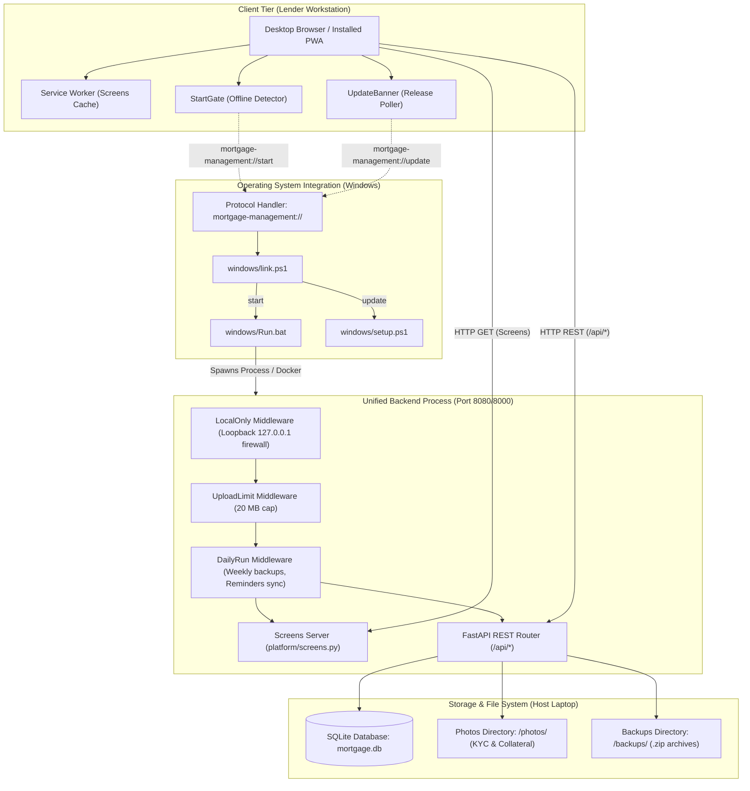
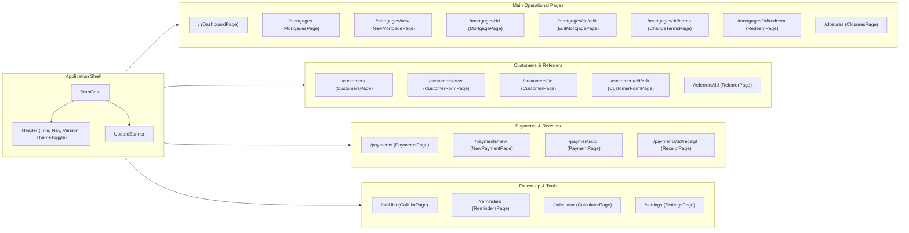
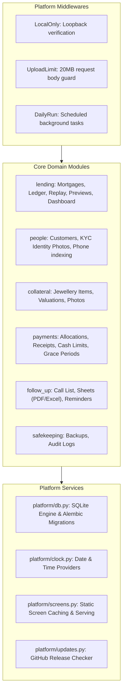
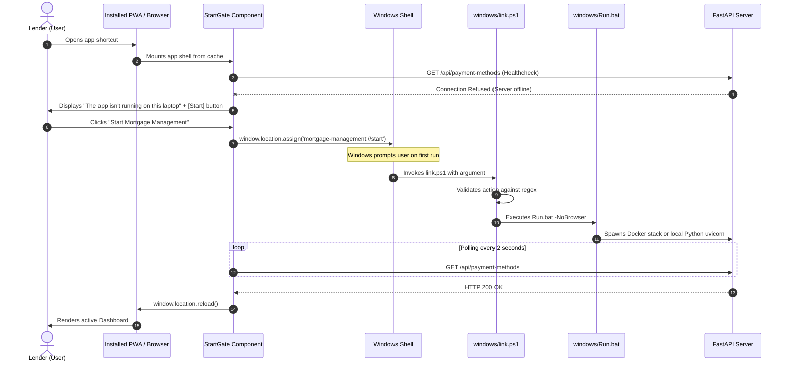
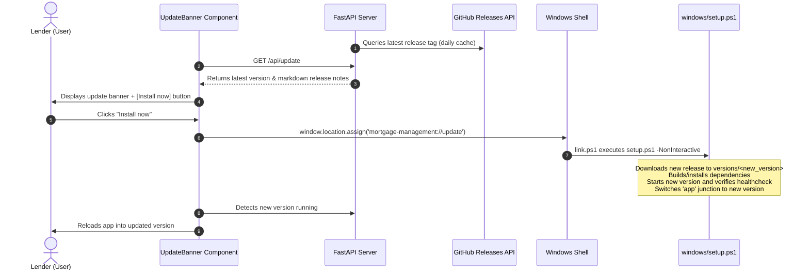
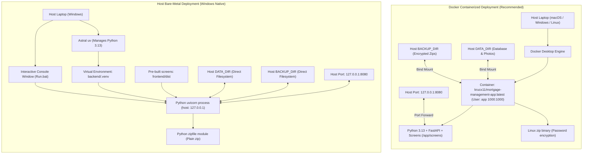

# System Architecture

This document describes the software architecture, subsystem structure, API endpoints, user interface pages, custom OS protocol integration, and deployment topologies of **Mortgage Management**.

Related architectural decisions are recorded in [Documentation/adr](adr/); domain vocabulary is defined in [Documentation/GLOSSARY.md](GLOSSARY.md).

---

## Table of Contents

1. [High-Level System Architecture](#1-high-level-system-architecture)
2. [Frontend Architecture & UI Pages](#2-frontend-architecture--ui-pages)
3. [Backend Architecture & Subsystems](#3-backend-architecture--subsystems)
4. [API Endpoints Reference](#4-api-endpoints-reference)
5. [Custom Protocol & OS Bridge (`mortgage-management://`)](#5-custom-protocol--os-bridge-mortgage-management)
6. [Deployment Topology: Docker vs Host](#6-deployment-topology-docker-vs-host)
7. [Key Architectural Principles](#7-key-architectural-principles)

---

## 1. High-Level System Architecture

Mortgage Management is a local-first single-tenant desktop web application designed for a jewellery lender. All data resides exclusively on the lender's local workstation disk (`DATA_DIR`), and backups are exported to cloud-synced folders (`BACKUP_DIR`).

The system combines:
- A modern **React SPA** (with PWA offline capabilities).
- A unified **FastAPI backend** that simultaneously serves the REST API and the compiled static screens.
- A **Custom OS Protocol (`mortgage-management://`)** that bridges sandboxed browser UI events to Windows launcher scripts.
- A **Dual-Mode Deployment engine** supporting both Docker containerized execution and native bare-metal host execution.

---

## 2. Frontend Architecture & UI Pages

The frontend is a single-page application (SPA) built with **React 19**, **TypeScript**, and **Vite**. It employs **TanStack Query** for caching server state and **React Router v7** for client-side navigation.

### 2.1 State & Communication Stack
- **Server State & Caching**: `@tanstack/react-query` handles caching, background invalidation, and optimistic state.
- **Type-Safe API Client**: Built on `openapi-fetch`. Types are generated directly from the backend's OpenAPI specification (`openapi.json` -> `src/api.gen.ts`).
- **Styling & Theming**: Custom CSS variables with light and dark mode toggling (`ThemeToggle.tsx`).
- **External Communications**: Click-to-send WhatsApp integration (`WhatsApp.tsx`) using `https://wa.me/` URLs without external API dependencies ([ADR 0002](adr/0002-whatsapp-click-to-send.md)).

### 2.2 UI Page Hierarchy & Routes

### 2.3 UI Pages Reference Table

| Route Path | Page Component | Purpose & Key Features |
| :--- | :--- | :--- |
| `/` | `DashboardPage` | Portfolio dashboard: active loans, total outstanding balance, overdue accounts, monthly cash-in chart, and reminder notifications. |
| `/mortgages` | `MortgagesPage` | Paginated mortgage directory with status filtering (Active, Closed, Redeemed, Forfeited, Waived, Dormant) and search. |
| `/mortgages/new` | `NewMortgagePage` | Loan origination: customer selection/creation, collateral items (weights, purity, gold rate valuation), terms configuration, and photos. |
| `/mortgages/:id` | `MortgagePage` | Comprehensive mortgage view: dynamically computed accrued interest and outstanding balance, payment history, term changes, call notes, and actions. |
| `/mortgages/:id/edit` | `EditMortgagePage` | Correction of starting terms before payments or initial discrepancies ([ADR 0015](adr/0015-starting-terms-can-be-corrected.md)). |
| `/mortgages/:id/terms` | `ChangeTermsPage` | Dated interest rate or tenure renegotiation with before/after comparison previews. |
| `/mortgages/:id/redeem` | `RedeemPage` | Loan payoff interface: computes principal + accrued interest - discounts - grace period adjustments. |
| `/closures` | `ClosuresPage` | Manages dormant mortgages (zero-balance unclosed loans) and bulk batch closures (redeem all, forfeit all, waive all) with previews. |
| `/customers` | `CustomersPage` | Customer directory searchable by name and phone number. |
| `/customers/new` | `CustomerFormPage` | New customer onboarding: primary phone, alternate numbers, address, photo capture, and KYC identity documents. |
| `/customers/:id` | `CustomerPage` | Customer profile: contact details, ID cards (Aadhaar, PAN), linked mortgages, cumulative balance, and favours granted. |
| `/customers/:id/edit` | `CustomerFormPage` | Customer profile and KYC documentation update. |
| `/payments` | `PaymentsPage` | Chronological payment history ledger with date range and payment method filters. |
| `/payments/new` | `NewPaymentPage` | Payment entry: auto-allocates cash between multiple mortgages, checks cash handling limits, discount confirmation thresholds, and grace periods. |
| `/payments/:id` | `PaymentPage` | Detailed view of payment allocations (principal vs. interest), applied discounts, and voiding with rollback preview. |
| `/payments/:id/receipt` | `ReceiptPage` | Printable receipt and WhatsApp one-click sharing. |
| `/call-list` | `CallListPage` | Overdue follow-up queue: records phone call notes, exports printable PDF call sheets and Excel workbooks, imports updated spreadsheets. |
| `/reminders` | `RemindersPage` | Daily automated payment reminders: template generation, WhatsApp dispatch links, approve/skip workflows. |
| `/referrers/:id` | `ReferrerPage` | Referrer summary and attribution for introduced customers. |
| `/calculator` | `CalculatorPage` | Loan scenario simulator: what-if loan projections, compounding schedule visualization, and repayment modeling. |
| `/settings` | `SettingsPage` | System settings: gold rates per gram, default terms, cash limits, discount authorization limits, backup configuration, and message templates. |

---

## 3. Backend Architecture & Subsystems

The backend is built with **FastAPI**, **SQLAlchemy**, and **Alembic**, managed with Astral **uv**. It follows a modular monolith architecture organized into functional domain packages under `backend/src/mortgage_backend/`.

### 3.1 Domain Subsystems

1. **`lending`**:
   - **Derived Ledger Engine** (`ledger.py`, `replay.py`): Financial figures (accrued interest, outstanding balance, dormancy) are computed dynamically by replaying events rather than stored as mutable balances ([ADR 0001](adr/0001-ledger-is-derived-not-stored.md)).
   - **Interest Model** (`terms.py`): Calculates monthly interest based on the start-of-month principal balance ([ADR 0006](adr/0006-interest-on-start-of-month-principal.md)).
   - **Outstanding Calculation** (`mortgages.py`): Outstanding balance reflects the exact payoff amount required to redeem on the current date ([ADR 0011](adr/0011-outstanding-includes-interest-to-date.md)).
   - **Preview Engine** (`previews.py`): Implements dry-run previews across all loan mutations ([ADR 0007](adr/0007-preview-routes-written-out-by-hand.md)).

2. **`people`**:
   - Customer identification anchored by unique primary telephone number ([ADR 0005](adr/0005-primary-number-identifies-a-person.md)).
   - KYC card storage for ID proofs (e.g. Aadhaar, PAN cards) and portrait photographs.
   - Comprehensive customer change logs and history.

3. **`collateral`**:
   - Precious metals item ledger tracking gross weight, net weight, item descriptions, and purity (karats).
   - Real-time market valuation calculated against configurable gold rates per gram, with manual valuation override support.
   - High-resolution photographic evidence storage for pledged jewellery items.

4. **`payments`**:
   - Multi-mortgage payment allocation algorithm distributing payments across overdue interest and principal.
   - Statutory cash payment threshold detection and warnings.
   - Discount room checks and lender authorization gates for non-cash reductions ([ADR 0014](adr/0014-discounts-are-non-cash-payment-reductions.md)).
   - Grace period handling and stored grace concessions ([ADR 0020](adr/0020-grace-amount-let-off-is-stored.md)).

5. **`follow_up`**:
   - Overdue prioritization engine generating daily calling lists.
   - Export engines producing formatted Excel workbooks (`openpyxl`) and printable PDF call sheets (`reportlab`).
   - Automated payment reminder scheduler with WhatsApp message generation.

6. **`safekeeping`**:
   - Automated weekly backups on first daily usage ([ADR 0003](adr/0003-backup-to-synced-folder.md)).
   - Pre-migration safety backups triggered automatically before applying schema updates.
   - Zip archive generation with password encryption support in Docker environments.
   - Comprehensive audit logging recording user actions and field diffs.

---

## 4. API Endpoints Reference

All API routes are prefixed with `/api` and strictly enforce local-only access.

| Module / Tag | Method | Endpoint Path | Summary / Description |
| :--- | :--- | :--- | :--- |
| **Dashboard** | `GET` | `/api/dashboard` | Portfolio summary, active counts, overdue stats, and monthly totals. |
| **Mortgages** | `GET` | `/api/mortgages` | List mortgages with status, customer, and date filtering. |
| | `POST` | `/api/mortgages` | Create new mortgage loan. |
| | `POST` | `/api/mortgages/preview` | Preview mortgage creation and initial schedule. |
| | `GET` | `/api/mortgages/suggested-name` | Generate next default mortgage account name. |
| | `GET` | `/api/mortgages/{id}` | Retrieve single mortgage details and current ledger status. |
| | `PUT` | `/api/mortgages/{id}` | Update mortgage initial terms (correction). |
| | `POST` | `/api/mortgages/{id}/edit-preview` | Preview mortgage term correction. |
| | `GET` | `/api/mortgages/{id}/history` | Historical audit log of all changes to this mortgage. |
| | `GET` | `/api/mortgages/{id}/projection` | Future balance and interest projection calculations. |
| | `POST` | `/api/mortgages/{id}/term-changes` | Record a dated change to interest rate or terms. |
| | `POST` | `/api/mortgages/{id}/term-changes/preview` | Preview financial impact of a term change. |
| | `DELETE` | `/api/mortgages/{id}/term-changes/{change_id}` | Remove a term change record. |
| | `POST` | `/api/mortgages/{id}/redeem` | Redeem loan (full payoff). |
| | `POST` | `/api/mortgages/{id}/redeem-preview` | Preview redemption payoff calculation. |
| | `POST` | `/api/mortgages/{id}/forfeit` | Forfeit collateral to lender. |
| | `POST` | `/api/mortgages/{id}/forfeit-preview` | Preview collateral forfeiture. |
| | `POST` | `/api/mortgages/{id}/waive` | Waive outstanding balance. |
| | `POST` | `/api/mortgages/{id}/waive-preview` | Preview loan balance waiver. |
| | `POST` | `/api/mortgages/{id}/reopen` | Reopen a previously closed mortgage. |
| | `POST` | `/api/mortgages/{id}/reopen-preview` | Preview mortgage reopening. |
| | `GET` | `/api/mortgages/{id}/collateral` | Get collateral items and valuations. |
| | `PUT` | `/api/mortgages/{id}/collateral` | Update collateral items and valuations. |
| | `POST` | `/api/mortgages/{id}/collateral-preview` | Preview collateral modification. |
| | `POST` | `/api/mortgages/{id}/photos` | Upload collateral photo. |
| | `DELETE` | `/api/mortgages/{id}/photos/{photo_id}` | Delete collateral photo. |
| | `GET` | `/api/mortgages/{id}/call-notes` | List follow-up notes for mortgage. |
| | `POST` | `/api/mortgages/{id}/call-notes` | Add follow-up note. |
| **Customers** | `GET` | `/api/customers` | List customers with search by name/phone. |
| | `POST` | `/api/customers` | Create new customer profile. |
| | `POST` | `/api/customers/preview` | Preview new customer creation. |
| | `GET` | `/api/customers/{id}` | Get customer profile, loans, and ID cards. |
| | `PUT` | `/api/customers/{id}` | Update customer details. |
| | `PUT` | `/api/customers/{id}/preview` | Preview customer profile update. |
| | `DELETE` | `/api/customers/{id}` | Delete customer (if no active mortgages). |
| | `POST` | `/api/customers/{id}/delete-preview` | Preview customer deletion safety checks. |
| | `GET` | `/api/customers/{id}/history` | Audit log of customer edits. |
| | `GET` | `/api/customers/{id}/favours` | List favours/discounts granted to customer. |
| | `PUT` | `/api/customers/{id}/photo` | Upload customer profile photo. |
| | `PUT` | `/api/customers/{id}/id-photos/{card}` | Upload KYC ID document photo (Aadhaar/PAN). |
| | `DELETE` | `/api/customers/{id}/id-photos/{card}` | Remove KYC ID document photo. |
| **Payments** | `GET` | `/api/payments` | List payments with date range filtering. |
| | `POST` | `/api/payments` | Record new payment with mortgage allocations. |
| | `POST` | `/api/payments/preview` | Preview payment allocation and ledger impact. |
| | `GET` | `/api/payments/{id}` | Get payment breakdown and receipt details. |
| | `POST` | `/api/payments/{id}/void` | Void an existing payment. |
| | `POST` | `/api/payments/{id}/void-preview` | Preview ledger rollback of voiding payment. |
| | `GET` | `/api/payments/{id}/receipt` | Generate printable receipt data. |
| | `POST` | `/api/payments/grace-offer` | Calculate grace amount concession. |
| | `GET` | `/api/payment-methods` | List accepted payment methods (Cash, UPI, NEFT). |
| **Closures** | `GET` | `/api/closures/dormant` | List zero-balance dormant mortgages. |
| | `POST` | `/api/closures/redeem` | Batch redeem multiple mortgages. |
| | `POST` | `/api/closures/redeem-preview` | Preview batch redemption. |
| | `POST` | `/api/closures/forfeit` | Batch forfeit collateral on multiple mortgages. |
| | `POST` | `/api/closures/forfeit-preview` | Preview batch forfeiture. |
| | `POST` | `/api/closures/waive` | Batch waive multiple mortgages. |
| | `POST` | `/api/closures/waive-preview` | Preview batch waiver. |
| **Follow-Up** | `GET` | `/api/call-list` | Generate prioritized overdue call list. |
| | `GET` | `/api/call-list/export.pdf` | Download printable PDF call sheets. |
| | `GET` | `/api/call-list/export.xlsx` | Export call list to Excel workbook. |
| | `POST` | `/api/call-list/import` | Import call notes from completed Excel workbook. |
| | `POST` | `/api/call-list/import-preview` | Preview spreadsheet note import. |
| | `GET` | `/api/reminders` | List pending payment reminders. |
| | `POST` | `/api/reminders/{id}/approve` | Approve reminder for dispatch. |
| | `POST` | `/api/reminders/{id}/sent` | Mark reminder sent via WhatsApp. |
| | `POST` | `/api/reminders/{id}/skip` | Skip reminder. |
| **Settings** | `GET`, `PUT` | `/api/settings/gold-rates` | Read / update prevailing gold rates per gram. |
| | `GET`, `PUT` | `/api/settings/default-terms` | Read / update default lending terms. |
| | `GET`, `PUT` | `/api/settings/cash-limit` | Read / update statutory cash receipt threshold. |
| | `GET`, `PUT` | `/api/settings/discount-confirmation-limit` | Read / update threshold requiring discount approval. |
| | `GET`, `PUT` | `/api/settings/grace-period` | Read / update default grace period days. |
| | `GET`, `PUT` | `/api/settings/call-list` | Read / update call list parameters. |
| | `GET`, `PUT` | `/api/settings/messages` | Read / update WhatsApp message templates. |
| | `GET` | `/api/settings/messages/placeholders` | List available template placeholders. |
| | `PUT` | `/api/settings/backups` | Configure backup retention and schedule. |
| **Safekeeping** | `GET`, `POST` | `/api/backups` | View backup status / trigger immediate backup. |
| | `GET` | `/api/audit` | View system audit trail. |
| **Utility** | `POST` | `/api/simulation` | Run what-if loan amortization simulation. |
| | `GET` | `/api/search` | Global search across customers and mortgages. |
| | `GET` | `/api/people/by-phone` | Look up person by phone number. |
| | `GET` | `/api/photos/{file_name}` | Stream stored image file. |
| | `GET` | `/api/referrers/{id}` | Read referrer summary. |
| | `GET` | `/api/update` | Check for newer releases from GitHub. |

---

## 5. Custom Protocol & OS Bridge (`mortgage-management://`)

The installed Progressive Web App (PWA) opens from cached assets even when the local backend server is not running. Because a sandboxed browser cannot directly start operating system processes, Mortgage Management registers a custom URI scheme: `mortgage-management://` ([ADR 0008](adr/0008-pwa-starts-the-app-through-a-link.md)).

### 5.1 Protocol Actions & Registry Configuration

On Windows, `windows/install.ps1` registers the protocol under the current user hive (`HKCU\Software\Classes\mortgage-management`):
- `URL Protocol`: `""`
- `DefaultIcon`: `%USERPROFILE%\MortgageManagement\app\windows\MortgageManagement.ico`
- `shell\open\command`: `powershell.exe -NoProfile -ExecutionPolicy Bypass -File link.ps1 "%1"`

The protocol accepts only two exact actions (strictly validated by regex `^mortgage-management://(start|update)/?$`):
1. `mortgage-management://start`: Starts the app via `windows/Run.bat -NoBrowser`.
2. `mortgage-management://update`: Runs `windows/setup.ps1 -NonInteractive -InstallDir <dir>` to download and apply the latest release.

### 5.2 PWA Offline Startup Flow

### 5.3 In-App Self-Update Flow

---

## 6. Deployment Topology: Docker vs Host

The application supports two distinct runtime deployment modes, designed around the constraint that the backend serves the built screens directly on the same origin in both modes ([ADR 0010](adr/0010-backend-serves-screens-without-docker.md), [ADR 0013](adr/0013-one-image-backend-serves-screens-in-docker.md)).

### 6.1 Architectural Comparison Matrix

| Aspect | Docker Deployment (`docker compose`) | Host Deployment (Local Windows Setup) |
| :--- | :--- | :--- |
| **Primary Requirement** | Docker Desktop installed on workstation. | Windows PowerShell 5.1 + internet for first install. |
| **Runtime Process** | Single isolated Linux container (`app`) running under unprivileged UID `1000:1000`. | Native Windows process spawned directly via `uvicorn` using `backend\.venv\Scripts\python.exe`. |
| **Port Binding** | `127.0.0.1:${APP_PORT:-8080}:8000` (Docker loopback binding). | `127.0.0.1:${APP_PORT:-8080}` (FastAPI binds directly to 127.0.0.1). |
| **Static Screen Serving** | FastAPI serves `/app/screens` copied into the image during multi-stage build. | FastAPI serves `frontend/dist` shipped pre-compiled with release packages. Node.js is not required. |
| **Lifecycle Management** | Managed by Docker daemon (`restart: unless-stopped`). Survives terminal closure. | Runs in launcher console window (`Run.bat`). Closing console window stops the app. |
| **Backups & Encryption** | Password-protected ZIP archives generated using native Linux `zip -P`. | Standard unencrypted ZIP archives generated via Python's `zipfile` (Windows lacks native CLI passworded zip). |
| **Data Storage** | Bind mounts from host folders (`DATA_DIR` -> `/data`, `BACKUP_DIR` -> `/backups`). | Direct filesystem path access to `DATA_DIR` and `BACKUP_DIR`. |
| **Update Mechanism** | `docker compose pull && docker compose up -d --remove-orphans`. | `setup.ps1` installs side-by-side into `versions/<version>` and updates junction `app`. |
| **Development Mode** | Local multi-stage container build (`docker-compose.dev.yml`). | Dual hot-reload: Vite on `:5173` proxying `/api` to FastAPI on `:8000`. |

---

## 7. Key Architectural Principles

1. **The Ledger is Derived, Not Stored ([ADR 0001](adr/0001-ledger-is-derived-not-stored.md))**:
   No static ledger balances or amounts owed are persisted in tables. Current loan state, accrued interest, and payoff totals are dynamically calculated from the chronological stream of loan origination, term changes, and payments.

2. **The Transactional Preview Pattern ([ADR 0007](adr/0007-preview-routes-written-out-by-hand.md))**:
   Every state-modifying action (redeeming, waiving, forfeiting, term adjustments, customer edits, payment voiding) has an identical `/preview` API route. The preview endpoint executes the genuine production mutation inside a database transaction, calculates differences, and rolls back the transaction. This guarantees zero discrepancy between user previews and actual executions.

3. **Single Process, Single Origin ([ADR 0010](adr/0010-backend-serves-screens-without-docker.md), [ADR 0013](adr/0013-one-image-backend-serves-screens-in-docker.md))**:
   The FastAPI backend serves both the `/api/*` REST endpoints and the compiled frontend single-page application. This eliminates reverse proxy complexities (such as Nginx drift), avoids cross-origin resource sharing (CORS) security issues, and ensures identical caching semantics in both Docker and host modes.

4. **Zero Cloud Dependencies & Privacy by Design**:
   The entire application runs on the lender's local hardware without external database or authentication services. WhatsApp communication operates via client-side deep links (`https://wa.me/`) rather than external paid messaging APIs ([ADR 0002](adr/0002-whatsapp-click-to-send.md)).
