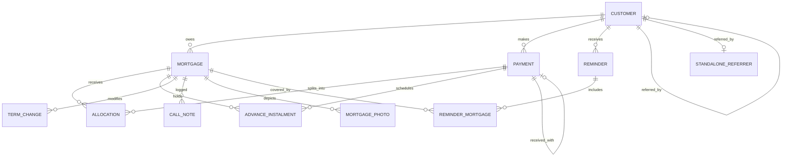
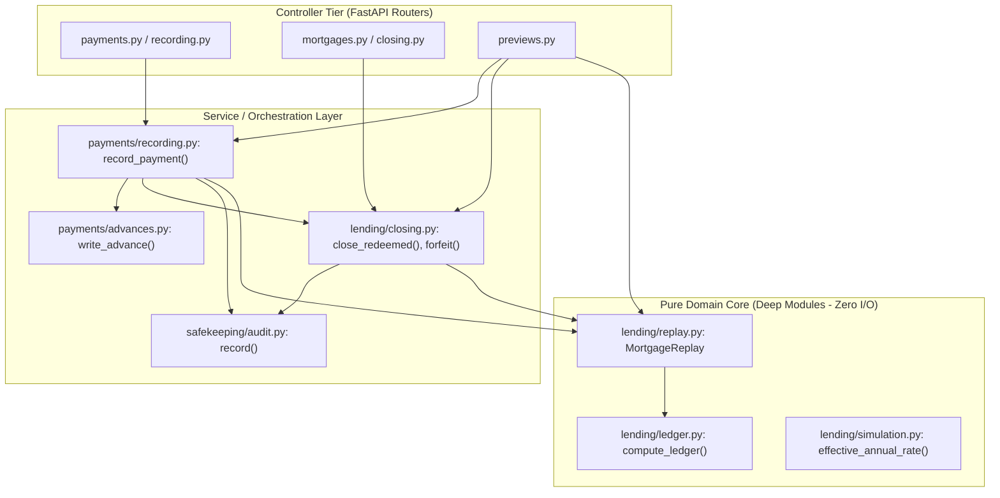
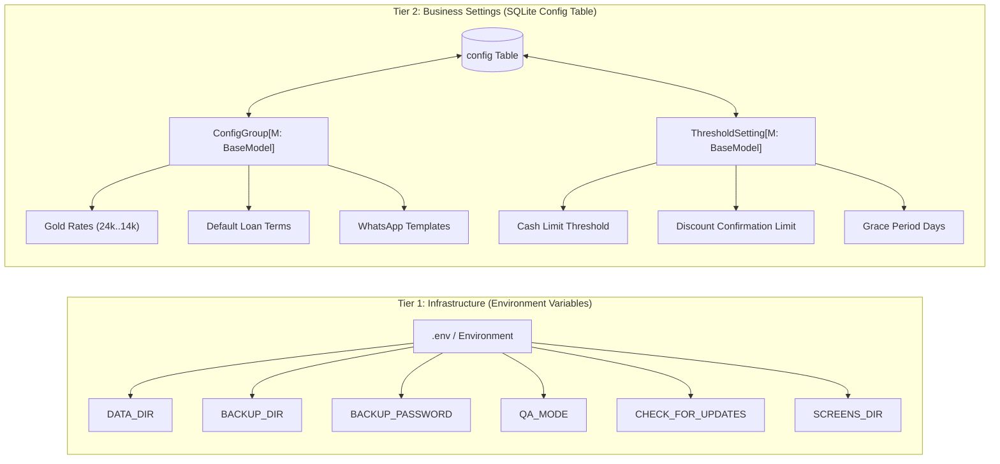

# Backend Architecture Review: Mortgage-Management-App

**Target System**: `krucx/Mortgage-Management-App` (`backend`)  
**Scope**: Backend architecture, data model, API design, state management, configuration, and dependencies  
**Reviewed Version**: `v3.5.2` (Python 3.13+, FastAPI, SQLAlchemy Core, Alembic, SQLite)  
**Date**: November 2026  

---

## Executive Summary

The backend of `Mortgage-Management-App` is a meticulously engineered, local-first modular monolith built for a jewellery mortgage lender. It reflects an uncommonly high degree of domain modeling discipline, architectural intentionality, and adherence to "deep module" design principles. Rather than falling into common tactical traps (such as leaky ORM abstractions, denormalized mutable balances, or ad-hoc route handlers), the system is anchored by several foundational architectural decisions:

- **Derived-not-stored ledger replay** ([ADR 0001](file:///Users/kritarthjain/Desktop/Kritarth/dev/worktree/Mortgage-Management-App/arch-backend/Documentation/adr/0001-ledger-is-derived-not-stored.md)): Loan balances, accrued interest, interest to date, and payoff amounts are never stored as mutable columns; they are computed dynamically and deterministically by replaying immutable events.
- **Transactional before/after previews** ([ADR 0007](file:///Users/kritarthjain/Desktop/Kritarth/dev/worktree/Mortgage-Management-App/arch-backend/Documentation/adr/0007-preview-routes-written-out-by-hand.md)): Every mutating API endpoint has an identical preview endpoint that executes the exact domain operation inside an isolated database transaction and rolls it back, calculating diffs without duplicated simulation logic.
- **Pure functional domain core**: The calculation engines ([ledger.py](file:///Users/kritarthjain/Desktop/Kritarth/dev/worktree/Mortgage-Management-App/arch-backend/backend/src/mortgage_backend/lending/ledger.py), [simulation.py](file:///Users/kritarthjain/Desktop/Kritarth/dev/worktree/Mortgage-Management-App/arch-backend/backend/src/mortgage_backend/lending/simulation.py)) are side-effect-free, database-agnostic pure functions with zero I/O dependencies.
- **Strict typing and unit precision**: Complete strict typing (`mypy strict = true`), Pydantic validation across all inputs, and integer-only financial arithmetic (paise for money, milligrams for precious metal weight, basis points for interest rates).

### Summary of Ratings

| Focus Area | Rating | Key Finding |
| :--- | :---: | :--- |
| **1. Data Model & Schema Design** | **STRATEGIC** | Coherent event-sourced data model; derived-not-stored ledger; strict integer units; rock-solid migration gates with automated backups. Minor tactical embedding of collateral/closure fields on `mortgage`. |
| **2. API Layer** | **STRATEGIC** | Thorough domain organization; exemplary transactional preview pattern; strict Pydantic validation and error normalization; 100% typed OpenAPI contract. Minor repetition of `/api` prefixes across router files. |
| **3. Business Logic Organization** | **STRATEGIC** | Classic deep modules (`ledger.py`, `replay.py`); ultra-thin controllers; clear orchestration layer (`recording.py`, `closing.py`). Tight coupling between lending and payments handled gracefully via layered primitives. |
| **4. State Management & Data Flow** | **MIXED** | Explicit, functional transaction scoping (`engine.begin()`, passing `conn: Connection`) eliminates hidden ORM state; however, raw SQL queries are colocated directly within route/service files without an isolated repository seam. |
| **5. Configuration & Environment** | **STRATEGIC** | Clean separation of concerns: 7 environment variables for process/infrastructure bootstrapping, database-backed `ConfigGroup[M]` for runtime domain settings; secret isolation; 100% dependency-injectable composition root. |
| **6. Dependencies & Tech Debt** | **STRATEGIC** | Extremely lean footprint (only 9 production dependencies); modern Python 3.13 features (PEP 695 generics); 916/916 passing unit/integration tests (62s runtime); zero lint or type errors. |

---

## 1. Data Model & Schema Design

**Rating**: **STRATEGIC**

### Assessment

The data schema is centrally defined in [platform/db.py](file:///Users/kritarthjain/Desktop/Kritarth/dev/worktree/Mortgage-Management-App/arch-backend/backend/src/mortgage_backend/platform/db.py) using SQLAlchemy Core `Table` definitions rather than ORM declarative base models. It represents a domain-first design tailored precisely to the Indian jewellery pawn/mortgage lending business.



### Key Architectural Strengths

1. **The Derived Ledger Invariant ([ADR 0001](file:///Users/kritarthjain/Desktop/Kritarth/dev/worktree/Mortgage-Management-App/arch-backend/Documentation/adr/0001-ledger-is-derived-not-stored.md))**:
   - In traditional CRUD accounting systems, tables like `mortgage` often store mutable columns such as `current_balance`, `accrued_interest`, or `last_payment_date`. Over time, bugs, race conditions, or voids cause these columns to desynchronize from transaction logs.
   - In this schema, `mortgage_table` ([platform/db.py:81-111](file:///Users/kritarthjain/Desktop/Kritarth/dev/worktree/Mortgage-Management-App/arch-backend/backend/src/mortgage_backend/platform/db.py#L81-L111)) has no balance or accrued interest columns. The table stores only the initial contract terms (`amount_lent`, `monthly_rate_bps`, `interest_mode`, `part_month_rule`, `start_date`). The ledger is derived on the fly by replaying `payment`, `allocation`, `advance_instalment`, and `term_change` records.
2. **Strict Integer Unit Normalization**:
   - Currency: Zero floating-point types (`REAL`/`FLOAT`). All monetary figures (`amount_lent`, `amount`, `discount`, `let_off`, `recovered_amount`, `collateral_override`) are stored as integer `paise` (1 INR = 100 paise), avoiding IEEE 754 precision loss.
   - Precious Metal Weight: All weights are stored in integer milligrams (`gross_weight_mg`, `net_weight_mg` in [platform/db.py:92-93](file:///Users/kritarthjain/Desktop/Kritarth/dev/worktree/Mortgage-Management-App/arch-backend/backend/src/mortgage_backend/platform/db.py#L92-L93)).
   - Interest Rates: Stored in basis points (`monthly_rate_bps`, where 200 bps = 2.00% per month).
3. **Relational Integrity Enforced in SQLite**:
   - SQLite does not enforce foreign keys by default. The engine explicitly binds an event listener on connect: `dbapi_connection.execute("PRAGMA foreign_keys = ON")` ([platform/db.py:291-294](file:///Users/kritarthjain/Desktop/Kritarth/dev/worktree/Mortgage-Management-App/arch-backend/backend/src/mortgage_backend/platform/db.py#L291-L294)).
   - Clean relational constraints: Case-insensitive unique index on mortgage names (`uq_mortgage_name` via `func.lower(mortgage_table.c.name)`), unique primary phone numbers (`customer.phone_1`, `standalone_referrer.phone`), unique PAN numbers (`customer.pan`), and unique term changes per mortgage per effective date (`UniqueConstraint("mortgage_id", "effective_on")`).
4. **Data Minimization & KYC Security**:
   - Aadhaar numbers store only the last 4 digits (`customer.aadhaar_last4`), adhering to privacy-by-design regulations.
   - Customer identity photos and collateral photos store only relative file names, with physical files isolated in a dedicated sibling directory ([platform/photos.py](file:///Users/kritarthjain/Desktop/Kritarth/dev/worktree/Mortgage-Management-App/arch-backend/backend/src/mortgage_backend/platform/photos.py)).
5. **Robust Migration Safety**:
   - [platform/db.py:307-338](file:///Users/kritarthjain/Desktop/Kritarth/dev/worktree/Mortgage-Management-App/arch-backend/backend/src/mortgage_backend/platform/db.py#L307-L338) implements `migrate()` with pre-flight checks: it refuses to open a database migrated by a newer version of the app (`known_revisions`), and executes an automated encrypted backup (`before-update`) prior to applying forward schema upgrades.

### Signs of Tactical Compromise

- **Mortgage Table Column Overloading**: `mortgage_table` ([platform/db.py:81-111](file:///Users/kritarthjain/Desktop/Kritarth/dev/worktree/Mortgage-Management-App/arch-backend/backend/src/mortgage_backend/platform/db.py#L81-L111)) has expanded to 21 columns. It bundles initial loan terms, collateral physical specs (`gross_weight_mg`, `net_weight_mg`, `purity_karat`), manual collateral valuation overrides (`collateral_override`, `collateral_override_on`), and closure/forfeiture results (`closed_on`, `redemption_payment_id`, `recovered_amount`, `closure_note`). In an enterprise multi-item pawn model, collateral and closures would be separate 1:N or 1:1 entity tables. However, for this single-packet jewellery domain, this denormalization is pragmatic and well-contained.
- **SQLAlchemy Reflection Warning**: SQLite reflection in tests issues warnings on expression-based indexes (`uq_mortgage_name`): `SAWarning: Skipped unsupported reflection of expression-based index uq_mortgage_name`.

---

## 2. API Layer

**Rating**: **STRATEGIC**

### Assessment

The API surface comprises 43 distinct endpoints exposed via FastAPI. Routes are organized into functional domain modules matching the business boundaries: lending, payments, people, collateral, follow-up, and safekeeping.

### Key Architectural Strengths

1. **Transactional Preview Architecture ([ADR 0007](file:///Users/kritarthjain/Desktop/Kritarth/dev/worktree/Mortgage-Management-App/arch-backend/Documentation/adr/0007-preview-routes-written-out-by-hand.md))**:
   - A critical problem in financial applications is UI simulation drift: frontend wizards or preview screens implement simulated math that diverges from real backend settlement writes.
   - The backend solves this by pairing every mutating endpoint with a `/api/...-preview` endpoint (e.g. `/api/payments/preview` vs `POST /api/payments`, `/api/mortgages/{id}/redeem-preview` vs `POST /api/mortgages/{id}/redeem`, `/api/mortgages/{id}/edit-preview` vs `PUT /api/mortgages/{id}`).
   - As implemented in [lending/previews.py:180-211](file:///Users/kritarthjain/Desktop/Kritarth/dev/worktree/Mortgage-Management-App/arch-backend/backend/src/mortgage_backend/lending/previews.py#L180-L211):
     ```python
     def _preview(conn: Connection, mortgage_ids: Sequence[int], today: date, change: Callable[[], object]) -> PreviewOfChange:
         try:
             before = _snapshot(conn, mortgage_ids, today)
             written = before_change(conn)
             change()
             after = _snapshot(conn, mortgage_ids, today)
             cash = cash_sums(conn, written)
         finally:
             conn.rollback()
         ...
     ```
   - The preview executes the **exact production domain write function** inside an active database connection and rolls it back in the `finally` block. If the operation would violate an invariant (e.g. overpayment, advance threshold, dormant status), the preview raises the exact same HTTP exception as the real save.
2. **Pydantic Validation & Custom Type Transformers**:
   - Input shapes are rigorously validated before hitting controllers.
   - Field sanitizers in [people/customers.py:33-93](file:///Users/kritarthjain/Desktop/Kritarth/dev/worktree/Mortgage-Management-App/arch-backend/backend/src/mortgage_backend/people/customers.py#L33-L93) use `Annotated[T, AfterValidator(...)]` to normalize Indian mobile numbers (`normalise_phone`), whitespace (`tidy_name`), email formats (`tidy_email`), masked Aadhaar (`tidy_aadhaar`), and PAN cards (`tidy_pan`).
   - Cross-field consistency is enforced via `@model_validator(mode="after")` (e.g. verifying that allocations sum up to the total payment amount, and that advance months are specified if an advance is held; [payments/writes.py:43-73](file:///Users/kritarthjain/Desktop/Kritarth/dev/worktree/Mortgage-Management-App/arch-backend/backend/src/mortgage_backend/payments/writes.py#L43-L73)).
   - Explicit field forbidding where appropriate (`model_config = ConfigDict(extra="forbid")` on `WaiveIn` in [lending/closing.py:63](file:///Users/kritarthjain/Desktop/Kritarth/dev/worktree/Mortgage-Management-App/arch-backend/backend/src/mortgage_backend/lending/closing.py#L63)).
3. **Generic Pagination Subsystem**:
   - [platform/paging.py](file:///Users/kritarthjain/Desktop/Kritarth/dev/worktree/Mortgage-Management-App/arch-backend/backend/src/mortgage_backend/platform/paging.py) provides a high-leverage generic abstraction: `Page[T]` and `Sorting[K]`.
   - It supports dual-mode pagination: `query_page` for database-level offset/limit queries, and `rows_page` for in-memory replayed lists. Both produce identical page contracts (`items`, `total`, `page`, `page_size = 20`).
4. **Standardized Error Semantics**:
   - Domain refusals are unified through `unprocessable(message)` in [platform/errors.py](file:///Users/kritarthjain/Desktop/Kritarth/dev/worktree/Mortgage-Management-App/arch-backend/backend/src/mortgage_backend/platform/errors.py), returning HTTP 422 with clear, customer- or lender-facing prose.
   - Contextual error tagging via `refusal_names_mortgage` ([lending/refusals.py:39-48](file:///Users/kritarthjain/Desktop/Kritarth/dev/worktree/Mortgage-Management-App/arch-backend/backend/src/mortgage_backend/lending/refusals.py#L39-L48)) automatically prefixes multi-loan validation errors with the specific loan name (e.g. `"2026-001: payment exceeds balance"`).
5. **Contract Synchronization**:
   - `openapi.py` ([openapi.py:1-24](file:///Users/kritarthjain/Desktop/Kritarth/dev/worktree/Mortgage-Management-App/arch-backend/backend/src/mortgage_backend/openapi.py#L1-L24)) boots an ephemeral in-memory instance (`sqlite://`) to dump `openapi.json` for frontend type generation via `openapi-fetch`. Type drift between frontend and backend is prevented at build time.

### Signs of Tactical Compromise

- **Repetitive Router Declarations**: Across 29 router files, every router declares `router = APIRouter(prefix="/api")`. In [main.py:135-163](file:///Users/kritarthjain/Desktop/Kritarth/dev/worktree/Mortgage-Management-App/arch-backend/backend/src/mortgage_backend/main.py#L135-L163), each router is included without prefix: `app.include_router(mortgages.router)`. A cleaner architectural pattern would mount routers to an `api_router = APIRouter(prefix="/api")` and register domain routers with their domain paths (e.g. `prefix="/mortgages"`).

---

## 3. Business Logic Organization

**Rating**: **STRATEGIC**

### Assessment

Business logic is cleanly decoupled from HTTP handling. Controller endpoints in FastAPI are thin facades (typically 5–15 lines) that unpack dependency-injected services (`conn`, `today`, `now`), call domain services, and return typed schemas.



### Key Architectural Strengths

1. **Exemplary "Deep Module" Design ([codebase-design skill](file:///Users/kritarthjain/Desktop/Kritarth/dev/worktree/Mortgage-Management-App/arch-backend/.agents/skills/codebase-design/SKILL.md))**:
   - [lending/ledger.py](file:///Users/kritarthjain/Desktop/Kritarth/dev/worktree/Mortgage-Management-App/arch-backend/backend/src/mortgage_backend/lending/ledger.py) is a masterpiece of deep module architecture:
     - **Interface**: Extremely compact (`compute_ledger(...)`, `project(...)`, `monthly_interest(...)`, `months_unpaid(...)`).
     - **Implementation**: Over 550 lines of complex financial replay logic (handling simple, yearly, and monthly compounding, part-month pro-rata vs full-month accruals, interest-to-date tracking, allocation cascades: unpaid interest $\to$ interest to date $\to$ principal $\to$ discount, and overpayment assertions).
     - **Zero I/O**: The file contains no SQL, no database connections, and no HTTP constructs. It can be tested in complete isolation with pure in-memory data structures (`Allocation`, `Terms`, `TermChange`).
2. **Replay as an Adapter Layer**:
   - [lending/replay.py](file:///Users/kritarthjain/Desktop/Kritarth/dev/worktree/Mortgage-Management-App/arch-backend/backend/src/mortgage_backend/lending/replay.py) bridges the raw database rows to the pure ledger engine. It defines `MortgageReplay`, loading a loan's historical facts once, caching ledger runs by `as_of` date, and projecting futures.
   - Batching optimization: `replays(conn, rows)` loads allocations, advance instalments, and term changes in single batch queries using `IN (...)` clauses, preventing $N+1$ query cascades when rendering tables.
3. **Orchestration vs Primitive Separation**:
   - In the payments subsystem, low-level database writes (`write_payment`, `write_void`) live in [payments/writes.py](file:///Users/kritarthjain/Desktop/Kritarth/dev/worktree/Mortgage-Management-App/arch-backend/backend/src/mortgage_backend/payments/writes.py).
   - High-level business orchestration (evaluating whether a payment pays off a mortgage and should trigger an automated redemption, distributing advances, and recording audit entries) lives in [payments/recording.py](file:///Users/kritarthjain/Desktop/Kritarth/dev/worktree/Mortgage-Management-App/arch-backend/backend/src/mortgage_backend/payments/recording.py).
4. **Self-Auditing Domain Operations**:
   - Mutations (creation, updates, closures, voids, advance cancellations) systematically log structured diffs to `audit_entry_table` via `safekeeping/audit.py` ([safekeeping/audit.py:74-100](file:///Users/kritarthjain/Desktop/Kritarth/dev/worktree/Mortgage-Management-App/arch-backend/backend/src/mortgage_backend/safekeeping/audit.py#L74-L100)). Diffs capture field names, old values, and new values as text representations.

### Signs of Tactical Compromise

- **Lending $\leftrightarrow$ Payments Interdependence**: `payments/recording.py` imports `close_redeemed` from `lending/closing.py`, while `lending/closing.py` imports `write_payment` and `PaymentIn` from `payments/writes.py`. While carefully layered to prevent circular Python imports, this indicates that Lending and Payments are conceptually tightly coupled in the problem domain.

---

## 4. State Management & Data Flow

**Rating**: **MIXED**

### Assessment

State management and database data flow exhibit outstanding transactional discipline and zero reliance on mutable global state. However, the data-access layer lacks a clean architectural seam (such as a repository or query object pattern), leaving SQL statements directly interspersed across service and route files.

### Key Architectural Strengths

1. **Explicit, Functional Connection Passing**:
   - There are no global database sessions, thread-local proxies, or implicit ORM sessions.
   - Every function that interacts with the database explicitly takes `conn: Connection` as its first parameter ([platform/db.py](file:///Users/kritarthjain/Desktop/Kritarth/dev/worktree/Mortgage-Management-App/arch-backend/backend/src/mortgage_backend/platform/db.py)).
   - Transaction boundaries are unequivocally controlled at the controller/entrypoint level:
     - Mutating operations: `with engine.begin() as conn:` (guarantees atomic commit or rollback on exception).
     - Read-only operations: `with engine.connect() as conn:`.
     - Preview simulations: `with engine.connect() as conn:` with explicit `finally: conn.rollback()`.
2. **Deterministic Derived State**:
   - State flows linearly:
     $$\text{Stored Raw Events (DB)} \xrightarrow{\text{replays()}} \text{MortgageReplay} \xrightarrow{\text{compute\_ledger()}} \text{LedgerSnapshot / Outstanding}$$
   - This uni-directional data flow ensures that state is never "out of sync" between cache, database, and client.
3. **Concurrency-Safe Background Daemons**:
   - Even though SQLite uses file-level locking, concurrent in-process background workers ([safekeeping/backups.py](file:///Users/kritarthjain/Desktop/Kritarth/dev/worktree/Mortgage-Management-App/arch-backend/backend/src/mortgage_backend/safekeeping/backups.py), [platform/daily_run.py](file:///Users/kritarthjain/Desktop/Kritarth/dev/worktree/Mortgage-Management-App/arch-backend/backend/src/mortgage_backend/platform/daily_run.py), and [platform/updates.py](file:///Users/kritarthjain/Desktop/Kritarth/dev/worktree/Mortgage-Management-App/arch-backend/backend/src/mortgage_backend/platform/updates.py)) manage concurrency through internal `threading.Lock()` primitives.

### Why State Management is Rated MIXED

- **No Repository Seam (Direct SQL Sprawl)**:
  - While using SQLAlchemy Core expressions rather than an ORM avoids ORM bloat, raw SQL queries (`select()`, `insert()`, `update()`, `join()`, `where()`) are scattered across dozens of domain files ([mortgages.py](file:///Users/kritarthjain/Desktop/Kritarth/dev/worktree/Mortgage-Management-App/arch-backend/backend/src/mortgage_backend/lending/mortgages.py), [dashboard.py](file:///Users/kritarthjain/Desktop/Kritarth/dev/worktree/Mortgage-Management-App/arch-backend/backend/src/mortgage_backend/lending/dashboard.py), [receipts.py](file:///Users/kritarthjain/Desktop/Kritarth/dev/worktree/Mortgage-Management-App/arch-backend/backend/src/mortgage_backend/payments/receipts.py), [customers.py](file:///Users/kritarthjain/Desktop/Kritarth/dev/worktree/Mortgage-Management-App/arch-backend/backend/src/mortgage_backend/people/customers.py)).
  - For example, [lending/dashboard.py:108-124](file:///Users/kritarthjain/Desktop/Kritarth/dev/worktree/Mortgage-Management-App/arch-backend/backend/src/mortgage_backend/lending/dashboard.py#L108-L124) executes inline ad-hoc queries against `payment_table` and `mortgage_table` to compute trends. Similarly, `receipts.py` constructs ad-hoc multi-table joins.
  - If schema column names change or query patterns need instrumentation/profiling, there is no single data-access abstraction layer to modify. While adhering to YAGNI for a single-developer SQLite project, from an architectural standpoint it represents a mixed structural pattern.

---

## 5. Configuration & Environment Management

**Rating**: **STRATEGIC**

### Assessment

Configuration and environment variable handling follows a disciplined dual-tier architecture: static system/infrastructure settings are managed via process environment variables, while dynamic business/lender settings are managed via a database-backed, type-safe configuration abstraction.



### Key Architectural Strengths

1. **Strictly Minimized Environment Surface Area**:
   - An audit of the codebase reveals exactly 7 environment variables across the entire application:
     1. `DATA_DIR` ([platform/db.py:272](file:///Users/kritarthjain/Desktop/Kritarth/dev/worktree/Mortgage-Management-App/arch-backend/backend/src/mortgage_backend/platform/db.py#L272))
     2. `BACKUP_DIR` ([safekeeping/backups.py:38](file:///Users/kritarthjain/Desktop/Kritarth/dev/worktree/Mortgage-Management-App/arch-backend/backend/src/mortgage_backend/safekeeping/backups.py#L38))
     3. `BACKUP_PASSWORD` ([safekeeping/backups.py:42](file:///Users/kritarthjain/Desktop/Kritarth/dev/worktree/Mortgage-Management-App/arch-backend/backend/src/mortgage_backend/safekeeping/backups.py#L42))
     4. `QA_MODE` ([platform/local_only.py:13](file:///Users/kritarthjain/Desktop/Kritarth/dev/worktree/Mortgage-Management-App/arch-backend/backend/src/mortgage_backend/platform/local_only.py#L13), [platform/clock.py:21](file:///Users/kritarthjain/Desktop/Kritarth/dev/worktree/Mortgage-Management-App/arch-backend/backend/src/mortgage_backend/platform/clock.py#L21))
     5. `CHECK_FOR_UPDATES` ([platform/updates.py:62](file:///Users/kritarthjain/Desktop/Kritarth/dev/worktree/Mortgage-Management-App/arch-backend/backend/src/mortgage_backend/platform/updates.py#L62))
     6. `SCREENS_DIR` ([platform/screens.py:19](file:///Users/kritarthjain/Desktop/Kritarth/dev/worktree/Mortgage-Management-App/arch-backend/backend/src/mortgage_backend/platform/screens.py#L19))
     7. `TZ` (standard system timezone for business dates)
   - All environment variables are documented with clear defaults in [.env.example](file:///Users/kritarthjain/Desktop/Kritarth/dev/worktree/Mortgage-Management-App/arch-backend/.env.example).
2. **Type-Safe In-Database Settings (`ConfigGroup` & `ThresholdSetting`)**:
   - Dynamic business settings that the lender can modify from the UI (gold rates per gram, message templates, call list thresholds, cash limits, default interest terms) are stored in the SQLite `config` table.
   - [platform/settings.py](file:///Users/kritarthjain/Desktop/Kritarth/dev/worktree/Mortgage-Management-App/arch-backend/backend/src/mortgage_backend/platform/settings.py) defines two generic abstractions:
     - `ConfigGroup[M: BaseModel]`: Encapsulates a prefix and Pydantic model. Handles validation, serialization, and post-update reactive hooks (`after_set: Sequence[AfterSet]`).
     - `ThresholdSetting[M: BaseModel]`: Distinguishes between "never set" (fallback to system default) and "cleared/disabled" (stored as empty string).
3. **Pure Composition Root & Dependency Injection**:
   - In [main.py:66-74](file:///Users/kritarthjain/Desktop/Kritarth/dev/worktree/Mortgage-Management-App/arch-backend/backend/src/mortgage_backend/main.py#L66-L74), `create_app(...)` receives all configuration parameters explicitly:
     ```python
     def create_app(
         database_url: str,
         today: Callable[[], date] = date.today,
         now: Callable[[], datetime] = datetime.now,
         backup_dir: Path | None = None,
         backup_password: str = "",
         screens_dir: Path | None = None,
         latest_release: LatestRelease | None = None,
     ) -> FastAPI:
     ```
   - No module internally reads environment variables inside business logic; everything flows through `create_app` or FastAPI request state (`request.app.state`). This allows unit tests to instantiate test applications with custom clocks, memory databases, or mock update fetchers without monkey-patching `os.environ`.
4. **Secret Isolation**:
   - The single secret—`BACKUP_PASSWORD` (used to encrypt backup zip archives via AES/zipfile)—is injected at boot time, retained only in memory within the `Backups` instance, and never logged or persisted to the database.

---

## 6. Dependencies & Tech Debt

**Rating**: **STRATEGIC**

### Assessment

The project maintains an exceptionally disciplined dependency profile, demonstrating restraint against library bloat and leveraging standard library capabilities where external packages are unnecessary.

### Dependency Audit

From [backend/pyproject.toml](file:///Users/kritarthjain/Desktop/Kritarth/dev/worktree/Mortgage-Management-App/arch-backend/backend/pyproject.toml):

```toml
dependencies = [
    "alembic>=1.20.0",           # Database migrations
    "defusedxml>=0.7.1",         # XML security hardening (openpyxl support)
    "fastapi>=0.143.3",          # Modern ASGI web framework
    "fpdf2>=2.9.0",              # Lightweight PDF generation for Call Sheets
    "openpyxl>=3.1.5",           # Excel spreadsheet export/import
    "pillow>=13.0.0",            # Photo resizing & EXIF orientation normalization
    "python-multipart>=0.0.32",  # File upload parsing
    "sqlalchemy>=2.1.5",         # SQL expression language & engine
    "uvicorn[standard]>=0.54.0", # ASGI production server
]
```

### Key Architectural Strengths

1. **Extreme Dependency Minimization**:
   - Total runtime production dependencies: **9**.
   - No redundant HTTP client: Despite checking GitHub for software releases in [platform/updates.py](file:///Users/kritarthjain/Desktop/Kritarth/dev/worktree/Mortgage-Management-App/arch-backend/backend/src/mortgage_backend/platform/updates.py), the app uses standard library `urllib.request` rather than bundling `httpx` or `requests` into the production container image.
   - No redundant ORM/ActiveRecord packages: Relies strictly on SQLAlchemy Core.
   - Security consciousness: Explicitly includes `defusedxml` to prevent XML entity expansion attacks when parsing uploaded Excel workbooks.
2. **Modern Python 3.13 Baseline**:
   - Targets `requires-python = ">=3.13"`.
   - Adopts modern language features cleanly: PEP 695 type parameter syntax (`class Page[T](BaseModel):`, `class ConfigGroup[M: BaseModel]:`), PEP 604 union types (`str | None`), and structural pattern matching (`match ... case`).
3. **Rigorous Quality & Verification Metrics**:
   - **Type Safety**: Mypy is configured with `strict = true` and `plugins = ["pydantic.mypy"]`. Running `mypy src` reports **0 errors across 79 source files**.
   - **Linting**: Ruff enforces flake8, pyflakes, import ordering, bugbear, and pyupgrade (`E4`, `E7`, `E9`, `F`, `I`, `B`, `UP`). Running `ruff check src` reports **All checks passed!**.
   - **Test Suite**: Pytest executes **916 unit and integration tests** in ~62 seconds with 100% pass rate.
4. **Resilient Local Security Middleware**:
   - [platform/local_only.py](file:///Users/kritarthjain/Desktop/Kritarth/dev/worktree/Mortgage-Management-App/arch-backend/backend/src/mortgage_backend/platform/local_only.py) provides custom ASGI middleware that inspects `Host` and `Origin` headers, blocking DNS rebinding and cross-origin CSRF attacks from external browser tabs while allowing native local app access.
   - [platform/upload_limit.py](file:///Users/kritarthjain/Desktop/Kritarth/dev/worktree/Mortgage-Management-App/arch-backend/backend/src/mortgage_backend/platform/upload_limit.py) enforces a 20 MB streaming cap, preventing memory exhaustion attacks from malformed multipart uploads.

### Identified Tech Debt & Minor Warnings

1. **Build System Version Pinning Warning**:
   - When invoking `uv`, the build system emits:
     ```
     warning: build_system.requires = ["uv-build>=0.12.24,<0.13.0"] does not contain the current uv version 0.13.9
     ```
     `pyproject.toml` should update `uv_build` upper bound to `<0.14.0`.
2. **Expression-Based Index Reflection Warning**:
   - During test fixture setup or metadata reflection, SQLAlchemy warns:
     `SAWarning: Skipped unsupported reflection of expression-based index uq_mortgage_name`.
3. **Colocated PDF Font Binaries**:
   - DejaVu font TTF files (`DejaVuSans.ttf`, `DejaVuSans-Bold.ttf`) are committed directly inside the Python source tree at `backend/src/mortgage_backend/follow_up/fonts/`. While practical for offline self-contained PDF generation, placing binary assets inside Python source packages is an atypical packaging pattern.

---

## 7. Actionable Architectural Recommendations

### High Leverage (Strategic Improvements)

1. **Consolidate Router Mounting**:
   - Remove redundant `prefix="/api"` across the 29 individual route files. Instead, declare sub-routers with their natural path (e.g. `router = APIRouter(prefix="/mortgages", tags=["mortgages"])`) and assemble them into a master API router:
     ```python
     api_router = APIRouter(prefix="/api")
     api_router.include_router(mortgages.router)
     api_router.include_router(payments.router)
     app.include_router(api_router)
     ```
2. **Abstract Common Query Patterns (Extract Query Modules)**:
   - Without introducing heavy repository classes, extract inline SQL queries from controllers (`dashboard.py`, `receipts.py`, `mortgages.py`) into dedicated query modules or query helper functions (e.g. `lending/queries.py` or `payments/queries.py`). This separates pure SQL query building from HTTP parameter parsing and response marshalling.

### Low Leverage (Tactical Cleanups)

1. **Update `uv_build` Constraint**:
   - In `backend/pyproject.toml`, adjust `uv_build` requirement to `uv_build>=0.12.24,<0.14.0` to eliminate build warnings.
2. **Move Font Assets to Platform/Package Resources**:
   - Relocate `follow_up/fonts/` into a dedicated package data location or access it via `importlib.resources`.
3. **Address SQLite Index Reflection Warning**:
   - Configure Alembic and test fixtures with `include_object` filters or explicit metadata definitions to silence benign reflection warnings for expression indexes.

---

## Conclusion

The backend architecture of `Mortgage-Management-App` is of exceptionally high quality. It adheres strictly to the single-responsibility principle, domain-driven design, and deep-module engineering. Its choice to derive the ledger dynamically rather than store mutable balances eliminates the primary source of bugs in financial lending software. The transactional preview pattern represents an industry gold standard for before-and-after UI feedback.

Apart from minor ergonomic refinements (consolidating router prefixes and extracting complex SQL queries from controllers), the architecture is robust, highly maintainable, and thoroughly verified.
