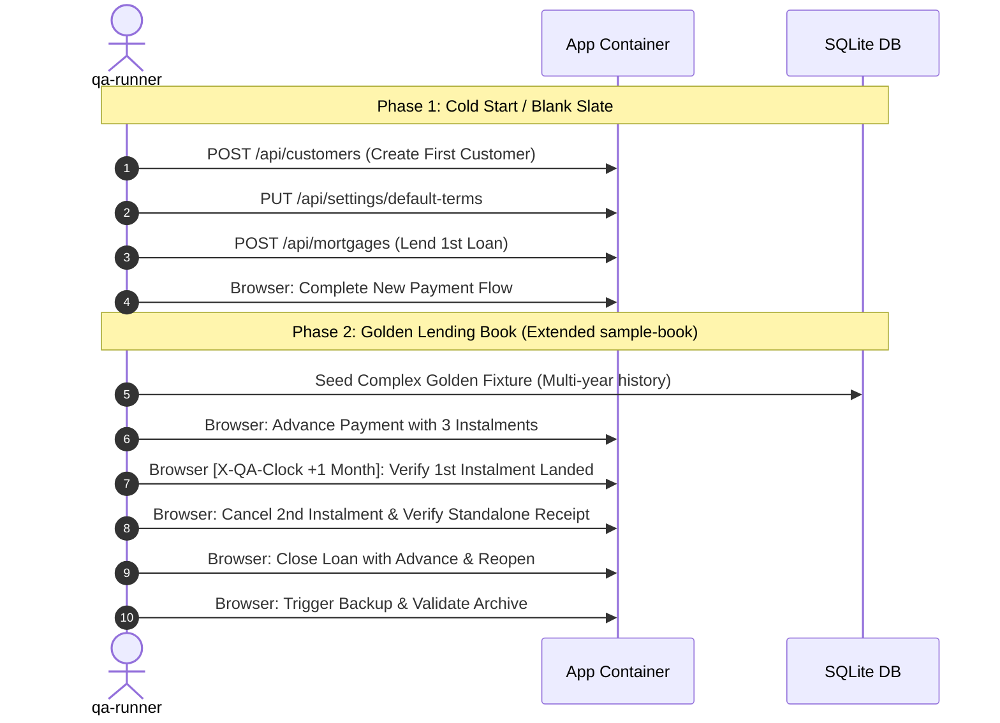

# Architectural Proposal: Comprehensive End-to-End QA Stack

**Status:** Proposed  
**Author:** Antigravity & Kritarth Jain  
**Date:** 2026-11-19  
**Decision Tree:** [Wayfinder Map Pending]  

---

## 1. Executive Summary & North Star

### The Problem
Today's QA stack (`scripts/qa-stack.sh up`) checks only that the single-service container boots from source on scratch data and responds at `GET /api/customers`. The existing scenario tests (`scripts/qa-scenarios.py`) verify REST API responses over HTTP, but **do not guarantee that the application works correctly for the Lender**.

Critical blind spots today:
1. **No Browser / UI Automation:** React component crashes, form recalculation synchronization bugs, modal overlay traps, CSS layout regressions, and mobile touch quirks are invisible to HTTP API scripts.
2. **Fixed Wall-Clock Time:** The application's domain logic relies on advancing time (monthly Accrual Dates, Advance instalment maturities, Grace periods, Reminders queueing, and Dormant status). The current container runs strictly on the host system clock, preventing automated verification of time-dependent features.
3. **Machine Inconsistency:** Running browser tests directly on developer host machines introduces environment variance (Node versions, OS-specific browser dependencies, missing system libraries).
4. **State Gaps:** Testing only fresh scratch databases misses complex historical edge cases, while testing only pre-seeded databases misses cold-start onboarding issues.

### The North Star
> **"Every time a developer or CI runs `scripts/qa-stack.sh test` and it passes, we have complete, deterministic confidence that the application works end-to-end for the Lender across all supported workflows, viewports, and lifecycles."**

---

## 2. System Architecture

To achieve absolute determinism across macOS, Linux, Windows, and GitHub Actions runners, the QA stack adopts a **dual-container architecture** orchestrated via `docker-compose.qa.yml`.

```mermaid
flowchart TB
    subgraph Host ["Host Machine / CI Runner"]
        CLI["scripts/qa-stack.sh test"]
    end

    subgraph DockerNet ["Docker Network: qa-network"]
        subgraph QARunner ["QA Runner Container (mortgage-qa-runner)"]
            PW["Playwright Test Engine"]
            Scenarios["E2E User Flow Scenarios"]
            Golden["Golden Fixture Seeder"]
        end

        subgraph App ["App Container (mortgage-management-app:qa)"]
            FastAPI["FastAPI Backend (QA_MODE=true)"]
            Static["Vite React SPA (/screens)"]
            Clock["Stateless Time-Travel Hook (X-QA-Clock)"]
            DB[(SQLite Scratch DB)]
            Backups[(Scratch Backups)]
        end
    end

    CLI -->|starts & monitors| DockerNet
    PW -->|Headless Chromium (HTTP/DOM)| Static
    PW -->|API Calls & Time-Travel Headers| FastAPI
    FastAPI --> Clock
    Clock --> DB
    FastAPI --> Backups
```

---

## 3. Core Architectural Pillars

### Pillar 1: Deterministic Test Orchestration (Dual-Container)

1. **`app` Service (`mortgage-management-app:qa`):**
   - Built from root [Dockerfile](file:///Users/kritarthjain/Desktop/Kritarth/dev/Mortgage-Management-App/Dockerfile) with development overrides (`docker-compose.dev.yml`).
   - Serves both frontend static bundle and `/api` on internal port 8000.
   - Runs non-root (`app:app` uid/gid 1000:1000).
   - Starts with `QA_MODE=true`.

2. **`qa-runner` Service (`mortgage-qa-runner:qa`):**
   - Built from `qa/Dockerfile.runner`, inheriting from the official Microsoft Playwright image (`mcr.microsoft.com/playwright:v1.49.0-noble`).
   - Contains pre-installed Chromium, Node.js, and Python dependencies.
   - Executes Playwright test suites targeting `http://qa-app:8000`.
   - Mounts a test-results scratch directory to export trace zips, failure screenshots, and execution logs back to the host.

### Pillar 2: Controllable Time-Travel Hook

Lending accounting, advance instalments, and reminders require time to pass. Mutating system clocks in Docker breaks container runtimes and TLS.

**Solution: Request-Scoped Stateless Time-Travel Header**
- In `backend/src/mortgage_backend/platform/db.py`, the `TodayDep` and `NowDep` dependency injections are updated:
  ```python
  def get_today(request: Request) -> date:
      if os.getenv("QA_MODE") == "true":
          qa_clock = request.headers.get("X-QA-Clock")
          if qa_clock:
              return date.fromisoformat(qa_clock)
      return date.today()
  ```
- **Security Guard:** This header is strictly ignored unless `QA_MODE=true` is set at process start. Production builds and standard dev compose configurations run with `QA_MODE=false`.
- **Stateless & Race-Free:** Parallel requests can specify different reference dates without polluting global state.
- **Frontend Playwright Integration:** Playwright contexts inject the header automatically via:
  ```typescript
  page.setExtraHTTPHeaders({ 'X-QA-Clock': '2026-11-05' });
  ```

### Pillar 3: Dual-Mode Testing Pipeline

A passing QA run exercises both ends of the lifecycle:



#### Phase 1: Blank-Slate (Cold-Start) Scenarios
- Tests the fresh Lender experience:
  - First-run wizard and default terms configuration.
  - Adding a customer with Aadhaar/PAN photo uploads.
  - Setting gold rates and creating the first mortgage.
  - Responsive layout validation at desktop width (1280px); a phone-width run is deferred.

#### Phase 2: Golden Lending Book Scenarios
- Built by extending `docs/sample-book/book.py` into `qa/fixtures/golden_book.py`.
- Populates rich historical data:
  - **Advance Payments:** Ramesh Kumar with multi-mortgage advance payments across 3 months.
  - **Instalment Transitions:** Advancing the clock across consecutive months to assert instalments automatically land in the ledger.
  - **Advance Cancellation:** Interactive modal cancellation, verifying ledger adjustment and standalone cancellation receipts.
  - **Closures & Reopen:** Redemptions where upcoming advances reduce cash needed, followed by reopening.
  - **Grace Period & Call List:** Verifying that mortgages covered by upcoming advances are excluded from daily Reminders and Call List "accruing today".
  - **Backup & Restore Lifecycle:** Taking a live backup via UI, clearing scratch data, and restoring to verify state preservation.

---

## 4. CLI Interface & Developer Experience

The repository's single entry point remains `scripts/qa-stack.sh`, enhanced with new subcommands:

```sh
# 1. Run the complete automated QA test suite (Dual container, returns exit code 0 or 1)
./scripts/qa-stack.sh test

# 2. Run only specific scenario stages
./scripts/qa-stack.sh test --mode fresh       # Only blank-slate tests
./scripts/qa-stack.sh test --mode golden      # Only golden-book tests

# 3. Interactive Headed Mode (for debugging UI on host machine)
./scripts/qa-stack.sh up --data /tmp/data --backups /tmp/backups
./scripts/qa-stack.sh test --ui               # Opens Playwright UI on host

# 4. Spin down containers and clean up QA network
./scripts/qa-stack.sh down
```

---

## 5. Work Breakdown & Wayfinder Map Structure

Because this effort spans backend dependencies, Docker configurations, fixture generation, and frontend browser tests, it will be mapped into Wayfinder decision and implementation tickets:

```
[wayfinder:map] Comprehensive Deterministic QA Stack
├── [wayfinder:research] Host-vs-Container Playwright performance & volume mount patterns
├── [wayfinder:prototype] Time-travel request hook (X-QA-Clock) in platform/db.py
├── [wayfinder:task] qa/Dockerfile.runner and docker-compose.qa.yml orchestration
├── [wayfinder:task] Extend sample-book into golden_book.py with Advance payment fixtures
├── [wayfinder:task] Playwright E2E scenario suite: Advances, Modals, Payments, Closures
└── [wayfinder:task] Update scripts/qa-stack.sh with `test` command and CI workflow hook
```

---

## 6. Verification & Acceptance Criteria

The QA stack will be considered complete and authoritative when:
1. `scripts/qa-stack.sh test` runs deterministically without host dependencies (Docker only).
2. All advance payment scenarios (Issues 399–406, PR 416, PR 417) pass through real browser automation (Chromium).
3. Fast-forwarding time via `X-QA-Clock` reliably advances mortgage states across calendar boundaries.
4. UI regressions (such as broken modal close affordances, form miscalculations, or viewport overflows) cause the test run to fail with captured screenshot artifacts.
5. The full suite is integrated into `.github/workflows/test.yml` as a required status check before release candidate merges.
